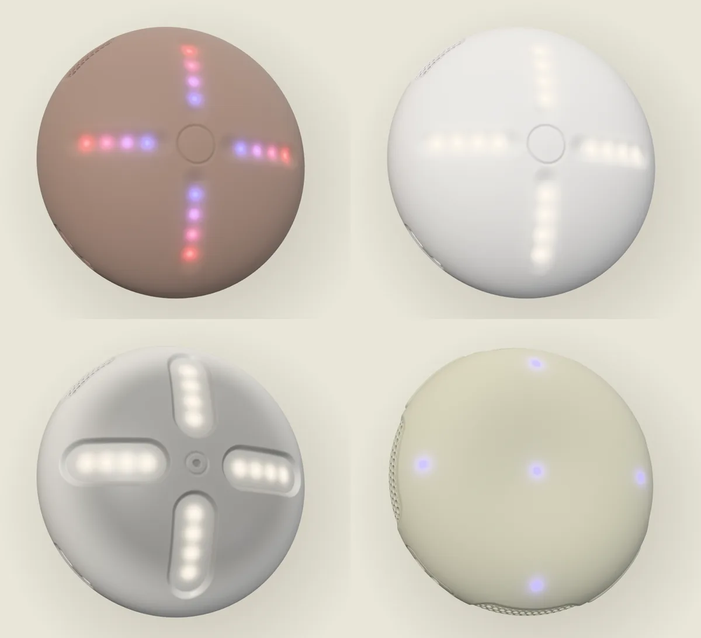
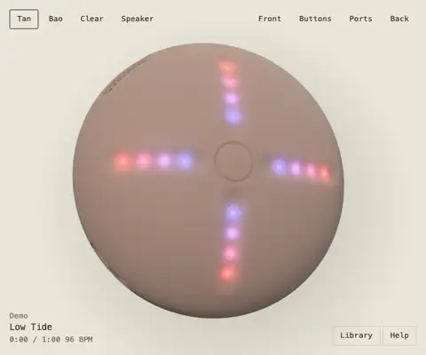
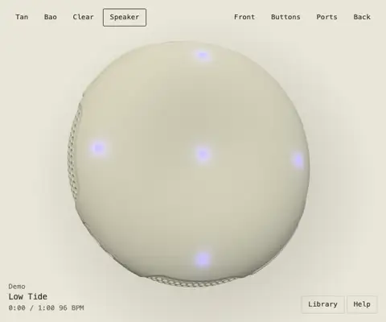
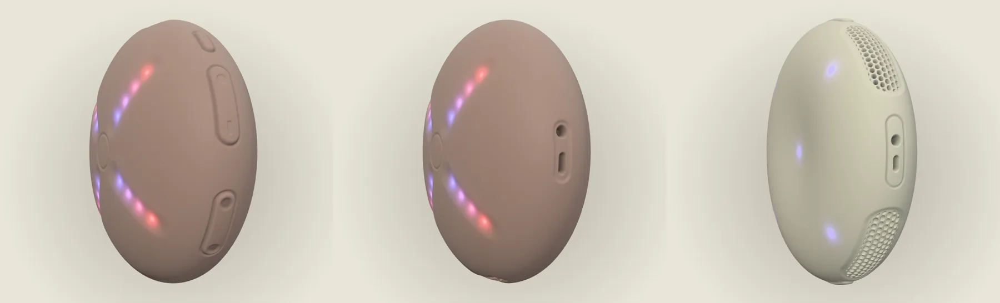

<div align="center">

# Four Stem Player

An unofficial browser replica of both generations of the four-stem hardware music player, in real-time 3D. It splits any song into stems on your own machine.

[Run it](#run-it) · [What it does](#what-it-does) · [Limits](#limits) · [Parity](docs/PARITY.md) · [Contributing](CONTRIBUTING.md)

   

</div>

Not affiliated with or endorsed by the makers of the original devices. No logos, product media or commercial music are in this repository.



| Handheld                                                                                                      | Speaker                                                                                                 |
| ------------------------------------------------------------------------------------------------------------- | ------------------------------------------------------------------------------------------------------- |
|  |  |

<!-- run-steps:start -->
## Run it locally, step by step

1. **Install [Node.js](https://nodejs.org) 22.12** or newer.

2. **Get the code:**

   ```sh
   git clone https://github.com/Gitguy268/stem-player.git
   cd stem-player
   ```

3. **Install the dependencies:**

   ```sh
   npm ci
   ```

4. **Start it:**

   ```sh
   npm start
   ```

   On a Mac you can double-click `start.command` instead of these two steps.

5. **Open <http://localhost:8791/>** in your browser. Press `Ctrl+C` in the terminal to stop.

> The stem splitter downloads a Demucs model from Hugging Face the first time you use it. That model repository states no licence, so the model is not part of this project and not covered by its licence.
<!-- run-steps:end -->

## Run it

You need [Node.js](https://nodejs.org) 22.12 or newer.

| You are on       | Do this                                                       |
| ---------------- | ------------------------------------------------------------- |
| Mac              | Double-click `start.command`                                  |
| Windows or Linux | `npm ci`, then `npm start`, then open `http://localhost:8791` |

Opening `index.html` directly can't work, because browsers block the audio workers on local files. The page tells you this if you try it.

## What it does

|              | Handheld (v1)                                         | Speaker (v2)                                   |
| ------------ | ----------------------------------------------------- | ---------------------------------------------- |
| **Look**     | Tan, bao and clear, turnable in 3D                    | Sand, turnable in 3D                           |
| **Controls** | 4 grooves with 16 lights, centre button, edge buttons | 5 touch points, edge buttons, port panel       |
| **Mix**      | Slide or isolate each stem                            | Isolate, or swap a stem in from another song   |
| **Loops**    | ¼ to 16 bars, locked or instant                       | ¼ to 2 beats, slip or standard                 |
| **Speed**    | 50 to 125 %, forward and reverse                      | Speed and pitch set separately, plus a scratch |
| **Extras**   | 8 effects, 60 s recordings, 4 slots                   | Staged transitions, minimal mode, storage mode |

Both can add music by:

- **Splitting any audio file**, using Demucs through WebGPU. The first split downloads a model of about 172 MB, which then stays in your browser. Your music never leaves your computer.
- **Importing stems**: four files named `1` to `4`, or `vocals`, `bass`, `drums`, `other`, with an optional `TRACK.txt`.
- **Demo tracks**, synthesised in code when they are first played.

<details>
<summary>Keyboard and mouse</summary>

| Input                 | Action                                            |
| --------------------- | ------------------------------------------------- |
| Drag the surface      | Turn the device                                   |
| Right click a control | Keep it held, for two-button moves with one mouse |
| `Space`               | Centre                                            |
| `P`                   | Power                                             |
| `=` and `-`           | Volume                                            |
| `[` and `]`           | Previous and next                                 |
| Arrows                | Stems. `Shift` + arrow on the handheld isolates   |
| `B`, `F`              | Speaker Bluetooth, FM                             |
| `L`                   | Library                                           |

The Help button lists each device's full controls.

</details>

<details>
<summary>How it is built</summary>

| Folder            | Holds                                                                            |
| ----------------- | -------------------------------------------------------------------------------- |
| `src/spec`        | Every number and mapping, for both devices                                       |
| `src/controllers` | Pure state machines for the controls, with no audio or graphics in them          |
| `src/engine`      | Web Audio: two decks of four stems on one clock, effects, pitch, recorder, tempo |
| `src/scene`       | Procedural geometry and LED shading. No model files or product images            |
| `src/input`       | Multi-touch pointer handling and hit testing                                     |
| `src/separate`    | The Demucs worker, with model download and caching                               |
| `src/library`     | Storage in the browser's private file system, and the demo synth                 |

</details>

The side buttons and ports are real controls. Turn the device, or use the Buttons and Ports views, to reach them.



## Limits

- Some details are best guesses, including the names of the 8 handheld effects and the speaker's recording gesture. [docs/PARITY.md](docs/PARITY.md) lists each one.
- Bluetooth pairing shows the lights and opens the browser's audio output picker where one exists, which is not yet in Chrome or Safari.
- Song links, streaming and online sessions are left out, since they need a backend.
- Splitting without WebGPU falls back to the processor, which is slower. On an Apple silicon Mac, 12 s of audio took 5 to 7 s on the graphics card, 11 s on the processor, and about 25 s on one processor thread, which is what static hosts such as GitHub Pages get without a graphics card. Other machines will differ.
- The live GitHub Pages site hasn't been tried yet. Its conditions were tested locally by serving without isolation headers.
- WebKit's private file storage wasn't available in testing, so songs may last only for the session there.
- A stem pack of 4 minutes takes around 340 MB of memory while playing, and double in reverse.

## Develop

```sh
npm ci
npm run dev             # serves on port 8792
npm run verify          # lint, format, types, unit tests, build
npm run check:browser   # needs a build; real input and audio in Chromium, Firefox, WebKit
npm run check:overlay   # needs docs/reference posters, which are not in the repo
npm run check:demucs    # downloads the model and runs real splits
```

Build with `npm run build`. The output in `dist/` is a static site.

## Licence

[MIT](LICENSE). The separation model is downloaded at run time and falls outside that grant. See [NOTICE](NOTICE).
